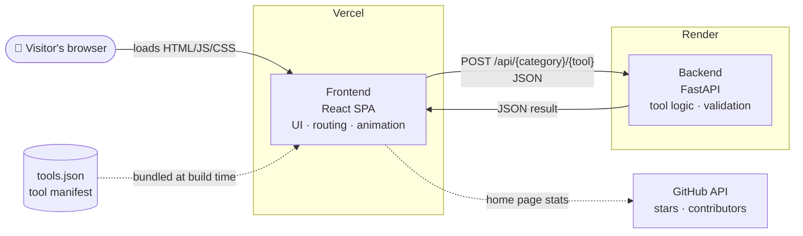
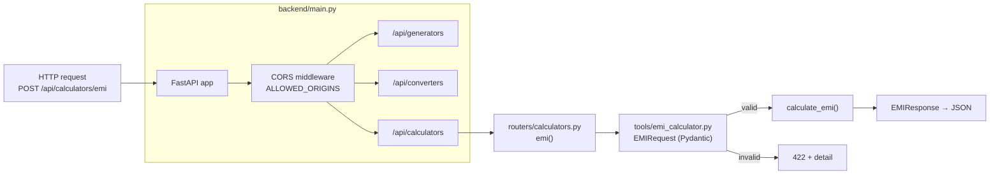
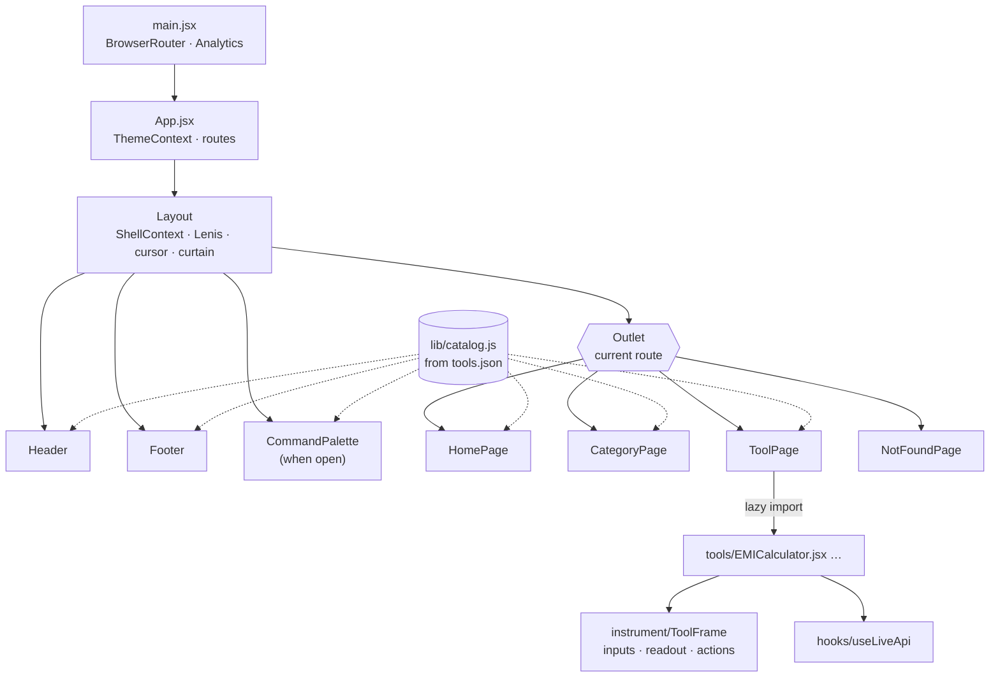
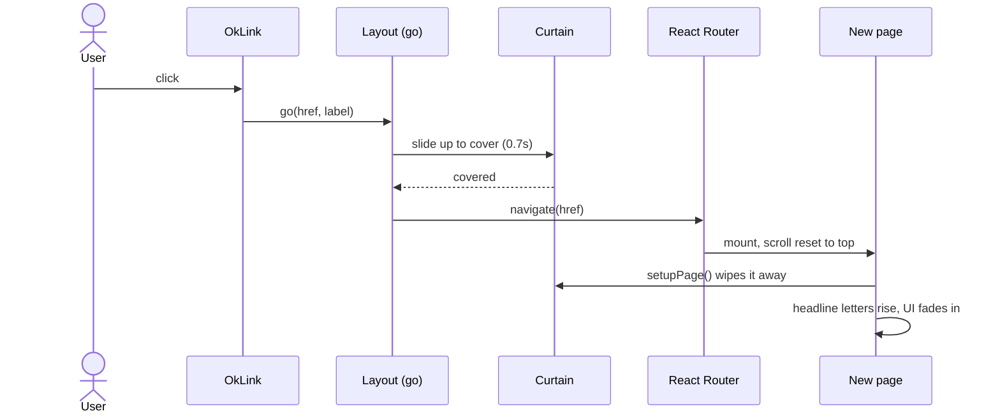
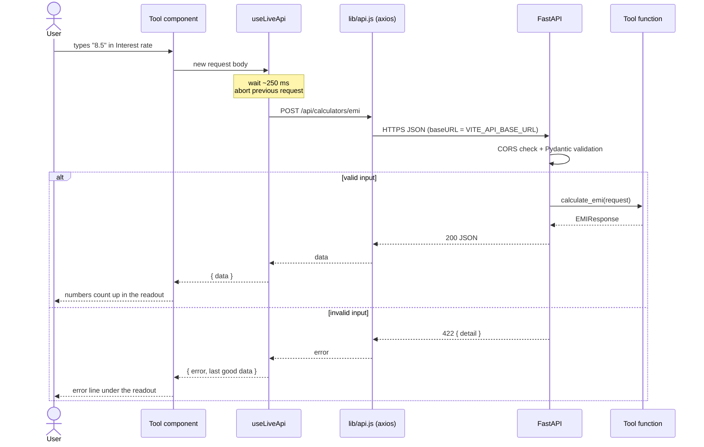
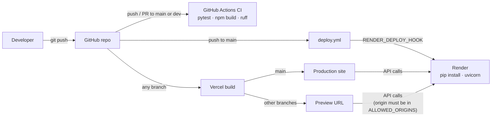

# How OmniKit Works

This document explains how OmniKit is put together: the frontend, the backend, how the two talk to each other, the technologies involved, and how it is deployed. Read it before your first contribution. For step-by-step instructions on building a tool, see the [Tool Developer Guide](TOOL_DEVELOPER_GUIDE.md).

---

## 1. The big picture

OmniKit is two independent apps that talk over HTTP:



- The **frontend** shows the interface. It never computes a tool's real result itself.
- The **backend** holds the logic for every tool (QR generation, EMI maths, unit conversion…), validates input and returns JSON.
- A single manifest, `frontend/src/registry/tools.json`, lists every tool. Navigation, search, the home page, category pages and the footer are all generated from it.

---

## 2. Repository layout

```text
ToolBox/
├── backend/                     FastAPI app
│   ├── main.py                  App entry: CORS, routers, health checks
│   ├── routers/                 One router per category (HTTP layer only)
│   │   ├── generators.py
│   │   ├── converters.py
│   │   └── calculators.py
│   ├── tools/                   Pure Python logic, one module per tool
│   ├── tests/                   Pytest suite, one file per tool
│   ├── requirements.txt         Runtime dependencies
│   └── render.yaml              Render service definition
│
├── frontend/                    Vite + React app
│   ├── index.html               Fonts, root element
│   ├── vite.config.js           React plugin, "@" alias, /api dev proxy
│   └── src/
│       ├── main.jsx             Mounts the app (router + Vercel Analytics)
│       ├── App.jsx              Route table
│       ├── index.css            Design tokens + base styles
│       ├── registry/tools.json  The tool manifest
│       ├── lib/                 Non-UI modules (catalog, motion, api, …)
│       ├── hooks/               React hooks (theme, page motion, live API, …)
│       ├── context/             Theme + shell (navigation, palette) contexts
│       ├── components/          Shell (Header, Footer, CommandPalette, Layout)
│       │   └── instrument/      Shared tool UI kit
│       ├── pages/               Home, Category, Tool, 404
│       ├── tools/               One component per tool
│       └── styles/              Per-area stylesheets
│
├── docs/                        Guides, changelog, this file
├── .github/workflows/           CI (tests, build, lint) and deploy hook
└── dev.bat                      Starts backend + frontend locally (Windows)
```

---

## 3. Backend

### Technologies

| Piece | Used for |
|---|---|
| **FastAPI** | HTTP framework, automatic OpenAPI docs at `/docs` |
| **Uvicorn** | ASGI server that runs the app |
| **Pydantic v2** | Request/response models and validation |
| **pint** | Unit conversion |
| **qrcode + Pillow** | QR code images |
| **python-dotenv** | Loads `backend/.env` in development |
| **Pytest** (+ httpx) | Tests through FastAPI's `TestClient` |
| **Ruff** | Linting in CI |

### Layers

Each tool goes through three layers:



1. **Model.** Pydantic `XRequest` / `XResponse` classes in `tools/<tool>.py`. Field validators reject bad input (for example, a password length outside 4–128 or a birth date in the future). FastAPI turns those failures into **422** responses automatically.
2. **Logic.** A plain function in the same module (`generate_qr`, `calculate_emi`, …) that takes the request model and returns the response model. It knows nothing about HTTP, so it is easy to test.
3. **Route.** A thin handler in `routers/<category>.py` that calls the function. `main.py` mounts each router under its prefix.

```python
# routers/calculators.py
@router.post("/emi", response_model=EMIResponse)
async def emi(request: EMIRequest):
    return calculate_emi(request)
```

### Endpoints

| Method | Path | Body → Response |
|---|---|---|
| POST | `/api/generators/qr-code` | `content, size, border, theme, transparent` → `image_base64` (PNG data URI) |
| POST | `/api/generators/password` | `length, include_uppercase/lowercase/numbers/symbols` → `password` |
| POST | `/api/generators/uuid` | `count, uppercase, remove_hyphens` → `uuids[]` |
| POST | `/api/converters/unit` | `value, from_unit, to_unit` (pint names) → `result, formula` |
| GET | `/api/converters/unit/supported` | → unit lists per quantity |
| POST | `/api/converters/color` | `color` (HEX/RGB/HSL) → `hex, rgb, hsl` |
| POST | `/api/calculators/emi` | `principal, annual_rate, tenure_months` → `emi, totals, schedule[]` |
| POST | `/api/calculators/bmi` | `weight_kg, height_cm` → `bmi, category` |
| POST | `/api/calculators/age` | `birth_date` (YYYY-MM-DD) → `years, months, days, total_days` |
| GET | `/` and `/health` | Health checks |

You can try every endpoint interactively at `http://localhost:8000/docs` while the backend runs.

### Configuration

| Variable | Default | Purpose |
|---|---|---|
| `ALLOWED_ORIGINS` | `http://localhost:5173` | Comma-separated list of frontend origins allowed by CORS |
| `APP_VERSION` | `0.1.0` | Shown in the OpenAPI docs |
| `APP_ENV` | none | `development` / `production` label |

---

## 4. Frontend

### Technologies

| Piece | Used for |
|---|---|
| **React 19 + Vite** | UI and dev server/bundler |
| **React Router v7** | Client-side routing |
| **axios** | HTTP client for the API |
| **GSAP + ScrollTrigger** | Scroll-driven and intro animations |
| **Lenis** | Smooth scrolling, driven by GSAP's ticker |
| **Plain CSS + custom properties** | Design tokens and the dark/light theme |
| **@vercel/analytics** | Page-view analytics in production |

### Component structure



### Routing

`App.jsx` defines four routes inside one shared `Layout`:

| Path | Page |
|---|---|
| `/` | `HomePage` |
| `/:category` | `CategoryPage` (shows the 404 page for unknown categories) |
| `/:category/:toolId` | `ToolPage` (shows the 404 page for unknown tools) |
| `*` | `NotFoundPage` |

Each tool component is loaded lazily, so a visitor only downloads the code for the tool they open.

### The manifest and the catalog

`tools.json` is the single source of truth. `lib/catalog.js` reads it and derives everything the pages need: tool codes (`TOOL/001`…), category chapters and their numbers, colours, the search index and project links. Adding an entry to `tools.json` (plus its component and endpoint) is enough for the tool to appear across the site.

### The shell

`components/Layout.jsx` wraps every page and owns the session-wide pieces:

- **Header**: section links on the home page, category tabs elsewhere, search and theme buttons.
- **Command palette**: opened with **Ctrl/⌘ K** or **/**. Searches names, categories, tags and codes.
- **Curtain transition**: an accent panel wipes across between pages. Internal links use `OkLink`, which plays the curtain and then navigates:



- **Smooth scrolling and pointer effects**: started once for the whole visit.
- **Footer**.

### Motion

`lib/motion.js` holds all animation logic. Pages opt in by adding `data-*` attributes to elements and calling `usePageMotion(ref)`:

| Attribute | Effect |
|---|---|
| `data-split="intro"` / `"scroll"` | Headline letters rise in on load / when scrolled into view |
| `data-intro` | Fades in after the headline |
| `data-batch` | Staggered reveal as items enter the viewport |
| `data-depth` | Parallax drift while scrolling |
| `data-hero`, `data-hscroll`, `data-chapters` | Pinned hero, horizontal featured track, pinned category chapters (desktop only) |
| `data-marquee` | Endless rows that react to scroll speed |
| `data-magnetic`, `data-tilt` | Pointer-following buttons and cards (fine pointers only) |

When a page unmounts, all its animations and pins are reverted, so nothing leaks between routes. Everything respects **prefers-reduced-motion**. Pinning and pointer effects are turned off on narrow screens.

### Theming

Colours, fonts and spacing are CSS custom properties in `src/index.css`. The theme is chosen by `data-theme="dark|light"` on `<html>`, saved in `localStorage`, and switched with a circular reveal that starts from the pointer.

### Tool pages and the instrument kit

Every tool renders inside `ToolFrame` (`components/instrument`): inputs on the left, a sticky "readout" panel on the right, and actions underneath. The kit also provides form controls (`Field`, `NumberField`, `Segmented`, `Chips`, `Toggle`) and animated readouts (`CountUp`, `Scramble`).

---

## 5. How the frontend talks to the backend

### The request path



Details worth knowing:

- **Live updates.** There is no "Calculate" button. `useLiveApi` re-sends the request whenever the body changes, after a short pause, and ignores responses that arrive out of order.
- **Errors.** A 422 from FastAPI carries a `detail` message. `apiError()` turns it into a readable sentence shown under the output. If the server cannot be reached, the tool shows "Could not reach the OmniKit API." The last good result stays on screen.
- **Presentation-only maths stays in the browser.** Values that only format or describe a result (password entropy, colour contrast, BMI scale position, "next birthday") are computed client-side. The tool results themselves always come from the API.

### Where the API URL comes from

| Environment | `VITE_API_BASE_URL` | Notes |
|---|---|---|
| Local | `http://localhost:8000` (`frontend/.env`) | Copy from `frontend/.env.example` |
| Production | The Render service URL | Set in Vercel → Project → Settings → Environment Variables |

`VITE_*` variables are baked in **at build time**, so changing one requires a redeploy.

### CORS

The browser only accepts API responses if the frontend's origin is in the backend's `ALLOWED_ORIGINS`. Origins must match exactly: scheme, host and port, with **no trailing slash**. Common symptoms:

- Running Vite on a port other than **5173** locally → every tool says "Could not reach the OmniKit API".
- A new deployment URL (for example a Vercel preview) → add it to `ALLOWED_ORIGINS` on Render.

---

## 6. Running it locally

On Windows, `dev.bat` opens both servers. To start them by hand:

```bash
# Backend: http://localhost:8000 (docs at /docs)
cd backend
python -m venv venv && venv\Scripts\activate      # macOS/Linux: source venv/bin/activate
pip install -r requirements.txt -r requirements-dev.txt
uvicorn main:app --reload

# Frontend: http://localhost:5173
cd frontend
npm install
npm run dev
```

Checks to run before opening a pull request:

```bash
cd backend && pytest tests/ -v && ruff check .
cd frontend && npx eslint src && npm run build
```

---

## 7. Deployment



| Part | Host | How it deploys |
|---|---|---|
| Frontend | **Vercel** | Vercel's GitHub integration builds every push. `main` goes to production, other branches get preview URLs. |
| Backend | **Render** (free web service) | A push to `main` runs `.github/workflows/deploy.yml`, which calls the `RENDER_DEPLOY_HOOK` secret. Render installs `requirements.txt` and starts `uvicorn main:app --host 0.0.0.0 --port $PORT`. |
| CI | **GitHub Actions** | `.github/workflows/ci.yml` runs backend tests, a frontend build and Ruff on pushes and PRs to `main` and `dev`. |

Free-tier behaviour to keep in mind: a free Render service **sleeps after about 15 minutes without traffic**. The first request after that waits roughly a minute while it wakes. A scheduled ping to `/health` keeps it awake.

---

## 8. Adding a tool, end to end

1. **Logic:** `backend/tools/my_tool.py` with request/response models and a function.
2. **Route:** add a handler to the matching `backend/routers/<category>.py`.
3. **Tests:** `backend/tests/test_my_tool.py`.
4. **Manifest:** add an entry to `frontend/src/registry/tools.json`.
5. **UI:** `frontend/src/tools/MyTool.jsx` built on `ToolFrame` + `useLiveApi`.
6. **Register the component:** add it to `TOOL_COMPONENTS` in `frontend/src/pages/ToolPage.jsx`.

The [Tool Developer Guide](TOOL_DEVELOPER_GUIDE.md) has a full component template.
